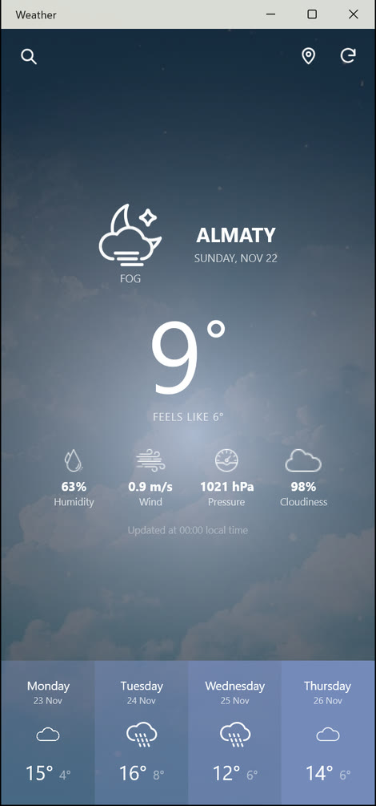
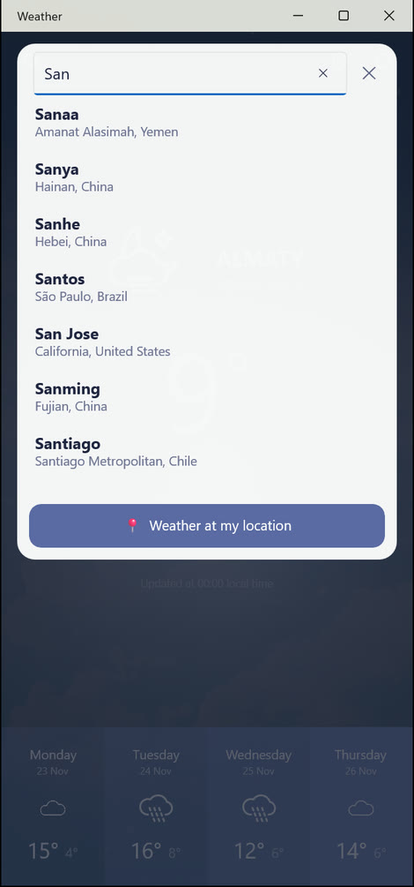
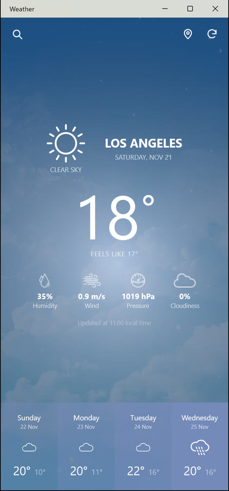
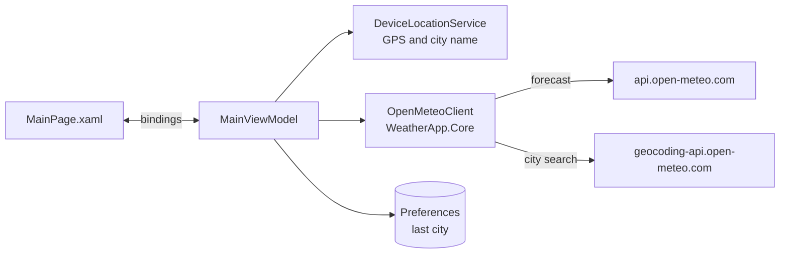

<div align="center">

# 🌤 Weather App

**The weather where you are, or in any city of the world: now and for the
next four days.**

A .NET MAUI app for Android, iOS, macOS and Windows. Data comes from
[Open-Meteo](https://open-meteo.com), so no API keys are needed: build it and
it works.

[](https://github.com/mredwardlik/weather-app/actions/workflows/build.yml)


| Night in Almaty | City search | Day in Los Angeles |
| :---: | :---: | :---: |
|  |  |  |

<sub>Screenshots of the Windows version with real data.</sub>

</div>

---

## ✨ Features

- 🌡 **Now**: temperature and how it feels, humidity, wind, pressure and
  cloudiness, with the local date and time of the city
- 📅 **Four days ahead**: day and night temperatures with an icon for each day
- 🔎 **Any city**: search while typing, in Latin letters or in Cyrillic
  ("Almaty" or "Алматы"), Enter picks the first result. The chosen city is
  remembered
- 📍 **Your location**: the weather where you are, if location is allowed.
  Without it the app just asks for a city
- 🎨 **Sky by the weather**: the background changes with the weather and the
  time of day: blue on a clear day, grey in fog, dark at night
- 🔄 **Fresh data**: pull down or press refresh. It updates by itself every
  15 minutes and when you come back to the app
- 🛡 **Clear errors**: no internet, a slow service or no location are shown as
  a message with a Retry button that repeats what failed

## 🔄 How it works



`WeatherApp.Core` is a plain .NET library without any UI: the Open-Meteo
client, the models and the meaning of WMO weather codes. That's the part
covered by tests, and it can be used anywhere.

## 🚀 Run

You need the [.NET 10 SDK](https://dotnet.microsoft.com/download) and the MAUI
workload of the platform you want.

```bash
git clone https://github.com/mredwardlik/weather-app.git
cd weather-app
```

**Windows**

```bash
dotnet workload install maui-windows
dotnet run --project WeatherApp -p:AppTargetFramework=net10.0-windows10.0.19041.0
```

**Android** (an emulator or a phone with USB debugging)

```bash
dotnet workload install maui-android
dotnet build WeatherApp -t:Run -p:AppTargetFramework=net10.0-android
```

**iOS and macOS** need a Mac with Xcode: `dotnet workload install maui`, then
`-p:AppTargetFramework=net10.0-ios` or `net10.0-maccatalyst`.

`AppTargetFramework` builds one platform, so the workloads of the others are
not needed. Visual Studio 2022 and Rider can open `WeatherApp.slnx` and run
any platform from the toolbar.

## 🧪 Tests

```bash
dotnet test WeatherApp.Tests
```

The client is tested with saved answers of Open-Meteo: parsing, the next
days, numbers in the URL with any system language, city search, and every
error (no connection, server errors, bad JSON, cancellation). One test checks
that every weather code has its icon in the app.

GitHub Actions runs the tests and builds the Android and Windows versions on
every push.

## 🗂 Project structure

```text
weather-app/
├── WeatherApp/                 # .NET MAUI app
│   ├── MainPage.xaml           # the screen: current weather, four days, search
│   ├── ViewModels/             # MainViewModel, background colors
│   ├── Services/               # location and city name of the device
│   ├── Views/DayTile.xaml      # one day of the forecast
│   ├── Resources/Images/       # weather icons w01d … w50n, background
│   └── Platforms/              # Android, iOS, macOS, Windows
├── WeatherApp.Core/            # Open-Meteo client, models, weather codes
├── WeatherApp.Tests/           # xUnit tests with saved API answers
└── WeatherApp.slnx
```

## 📜 History

The first version was written in 2021 with Xamarin.Forms, OpenWeatherMap and
photos of the city from Pexels. Xamarin is no longer supported since 2024,
so in 2026 the app moved to .NET MAUI and Open-Meteo. The design and the
icons stayed the same, the search, the errors and the tests are new.

## 📄 License

[MIT](LICENSE)
